#+TITLE: The Little Book of Deep Learning
#+AUTHOR: François Fleuret
#+LANGUAGE: en
#+OPTIONS: toc:2 num:t

* Contents :TOC:
- [[#the-little-book-of-deep-learning][The Little Book of Deep Learning]]
- [[#foreword][Foreword]]
- [[#part-i-foundations][Part I: Foundations]]
  - [[#chapter-1-machine-learning][Chapter 1: Machine Learning]]
    - [[#11-learning-from-data][1.1 Learning from data]]
    - [[#12-basis-function-regression][1.2 Basis function regression]]
    - [[#13-under-and-overfitting][1.3 Under and overfitting]]
    - [[#14-categories-of-models][1.4 Categories of models]]
  - [[#chapter-2-efficient-computation][Chapter 2: Efficient Computation]]
    - [[#21-gpus-tpus-and-batches][2.1 GPUs, TPUs, and batches]]
    - [[#22-tensors][2.2 Tensors]]
  - [[#chapter-3-training][Chapter 3: Training]]
    - [[#31-losses][3.1 Losses]]
      - [[#cross-entropy][Cross-entropy]]
      - [[#contrastive-loss][Contrastive loss]]
      - [[#engineering-the-loss][Engineering the loss]]
    - [[#32-autoregressive-models][3.2 Autoregressive models]]
      - [[#causal-models][Causal models]]
      - [[#tokenizer][Tokenizer]]
    - [[#33-gradient-descent][3.3 Gradient descent]]
      - [[#stochastic-gradient-descent][Stochastic Gradient Descent]]
    - [[#34-backpropagation][3.4 Backpropagation]]
      - [[#resource-usage][Resource usage]]
      - [[#vanishing-gradient][Vanishing gradient]]
    - [[#35-the-value-of-depth][3.5 The value of depth]]
    - [[#36-training-protocols][3.6 Training protocols]]
      - [[#fine-tuning][Fine-tuning]]
    - [[#37-the-benefits-of-scale][3.7 The benefits of scale]]
    - [[#38-large-scale-parallel-training][3.8 Large-Scale Parallel Training]]
      - [[#distributed-data-parallelism][Distributed Data Parallelism]]
      - [[#fully-sharded-data-parallelism][Fully Sharded Data Parallelism]]
      - [[#pipeline-and-tensor-parallelism][Pipeline and tensor parallelism]]
- [[#part-ii-deep-models][Part II: Deep Models]]
  - [[#chapter-4-model-components][Chapter 4: Model Components]]
    - [[#41-the-notion-of-layer][4.1 The notion of layer]]
    - [[#42-linear-layers][4.2 Linear layers]]
      - [[#43-activation-functions][4.3 Activation functions]]
      - [[#44-pooling][4.4 Pooling]]
      - [[#45-dropout][4.5 Dropout]]
      - [[#46-normalizing-layers][4.6 Normalizing layers]]
      - [[#47-skip-connections][4.7 Skip connections]]
      - [[#48-attention-layers][4.8 Attention layers]]
      - [[#multi-head-attention][Multi-head Attention]]
      - [[#49-token-embedding][4.9 Token embedding]]
      - [[#410-positional-encoding][4.10 Positional encoding]]
  - [[#chapter-5-architectures][Chapter 5: Architectures]]
    - [[#51-multi-layer-perceptrons][5.1 Multi-Layer Perceptrons]]
    - [[#52-convolutional-networks][5.2 Convolutional networks]]
    - [[#53-attention-models][5.3 Attention models]]
- [[#part-iii-applications][Part III: Applications]]
  - [[#chapter-6-prediction][Chapter 6: Prediction]]
    - [[#61-image-denoising][6.1 Image denoising]]
    - [[#62-image-classification][6.2 Image classification]]
    - [[#63-object-detection][6.3 Object detection]]
    - [[#64-semantic-segmentation][6.4 Semantic segmentation]]
    - [[#65-speech-recognition][6.5 Speech recognition]]
    - [[#66-text-image-representations][6.6 Text-image representations]]
    - [[#67-reinforcement-learning][6.7 Reinforcement learning]]
  - [[#chapter-7-synthesis][Chapter 7: Synthesis]]
    - [[#71-text-generation][7.1 Text generation]]
    - [[#72-image-generation][7.2 Image generation]]
  - [[#chapter-8-the-compute-schism][Chapter 8: The Compute Schism]]
    - [[#81-prompt-engineering][8.1 Prompt Engineering]]
    - [[#82-quantization][8.2 Quantization]]
    - [[#83-adapters][8.3 Adapters]]
    - [[#84-model-merging][8.4 Model merging]]
  - [[#the-missing-bits][The Missing Bits]]
  - [[#bibliography][Bibliography]]
  - [[#index][Index]]

* The Little Book of Deep Learning
François Fleuret

François Fleuret is a professor of computer science at the University of Geneva, Switzerland.

The cover illustration is a schematic of the Neocognitron by Fukushima [1980], a key ancestor of deep neural networks.

#+CAPTION: Neocognitron schematic from the book cover.
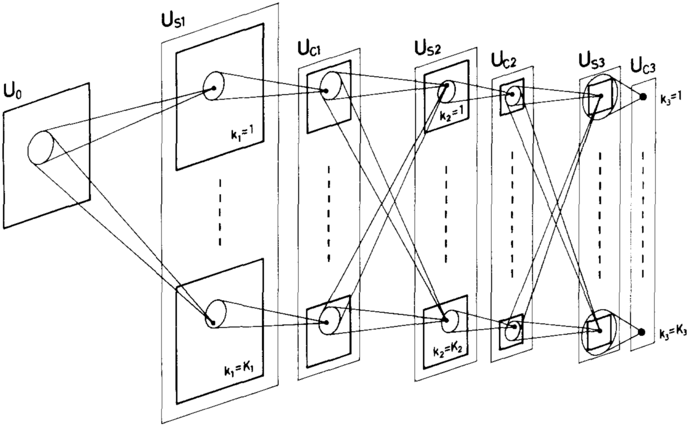

* Foreword
The current period of progress in artificial intelligence was triggered when Krizhevsky et al. [2012] demonstrated that an artificial neural network designed twenty years earlier [LeCun et al., 1989] could outperform complex state-of-the-art image recognition methods by a huge margin, simply by being a hundred times larger and trained on a similarly scaled-up dataset.

This breakthrough was made possible thanks to Graphics Processing Units (GPUs), highly parallel consumer-grade computing devices developed for real-time image synthesis and repurposed for artificial neural networks.

Since then, under the umbrella term of “deep learning,” innovations in the structures of these networks, the strategies to train them, and dedicated hardware have allowed for an exponential increase in both their size and the quantity of training data they take advantage of [Sevilla et al., 2022]. This has resulted in a wave of successful applications across technical domains, from computer vision and robotics to speech processing, and since 2020 in the development of Large Language Models with general proto-reasoning capabilities [Chowdhery et al., 2022].

Although the bulk of deep learning is not difficult to understand, it combines diverse components such as linear algebra, calculus, probabilities, optimization, signal processing, programming, algorithmics, and high-performance computing, making it complicated to learn.

Instead of trying to be exhaustive, this little book is limited to the background necessary to understand a few important models. This proved to be a popular approach, resulting in more than 500,000 downloads of the PDF file in the 12 months following its announcement on Twitter.

If you did not get this book from its official URL, please do so, to allow the estimation of the number of readers: https://fleuret.org/public/lbdl.pdf

François Fleuret, May 19, 2024

* Part I: Foundations
** Chapter 1: Machine Learning
Deep learning belongs historically to the larger field of statistical machine learning, as it fundamentally concerns methods that are able to learn representations from data. The techniques involved come originally from artificial neural networks, and the “deep” qualifier highlights that models are long compositions of mappings, now known to achieve greater performance.

The modularity, versatility, and scalability of deep models have resulted in a plethora of specific mathematical methods and software development tools, establishing deep learning as a distinct and vast technical field.

*** 1.1 Learning from data
The simplest use case for a model trained from data is when a signal $x$ is accessible, for instance, the picture of a license plate, from which one wants to predict a quantity $y$, such as the string of characters written on the plate.

In many real-world situations where $x$ is a high-dimensional signal captured in an uncontrolled environment, it is too complicated to come up with an analytical recipe that relates $x$ and $y$.

What one can do is to collect a large training set $\mathcal{D}$ of pairs $(x_n,y_n)$, and devise a parametric model $f$. This is a piece of computer code that incorporates trainable parameters $w$ that modulate its behavior, and such that, with the proper values $w^*$, it is a good predictor. “Good” here means that if an $x$ is given to this piece of code, the value $\hat{y}=f(x;w^*)$ it computes is a good estimate of the $y$ that would have been associated with $x$ in the training set had it been there.

This notion of goodness is usually formalized with a loss $\mathcal{L}(w)$ which is small when $f(\cdot;w)$ is good on $\mathcal{D}$. Then, training the model consists of computing a value $w^*$ that minimizes $\mathcal{L}(w)$.

Most of the content of this book is about the definition of $f$, which, in realistic scenarios, is a complex combination of pre-defined sub-modules.

The trainable parameters that compose $w$ are often called *weights*, by analogy with the synaptic weights of biological neural networks. In addition to these parameters, models usually depend on *hyperparameters*, which are set according to domain prior knowledge, best practices, or resource constraints. They may also be optimized in some way, but with techniques different from those used to optimize $w$.

*** 1.2 Basis function regression
We can illustrate the training of a model in a simple case where $x_n$ and $y_n$ are two real numbers, the loss is the mean squared error:

\begin{equation}
\mathcal{L}(w)=\frac{1}{N}\sum_{n=1}^{N}\left(y_n-f(x_n;w)\right)^2,
\end{equation}

and $f(\cdot;w)$ is a linear combination of a predefined basis of functions $f_1,\ldots,f_K$, with $w=(w_1,\ldots,w_K)$:

\begin{equation}
f(x;w)=\sum_{k=1}^{K}w_k f_k(x).
\end{equation}

Since $f(x_n;w)$ is linear with respect to the $w_k$ and $\mathcal{L}(w)$ is quadratic with respect to $f(x_n;w)$, the loss $\mathcal{L}(w)$ is quadratic with respect to the $w_k$, and finding $w^*$ that minimizes it boils down to solving a linear system. See Figure 1.1 for an example with Gaussian kernels as $f_k$.

#+CAPTION: Given a basis of functions (blue curves) and a training set (black dots), an optimal linear combination (red curve) approximates the training set for the mean squared error. (PDF page 14.)
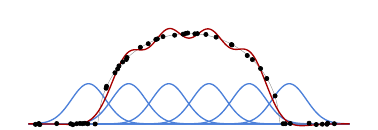

*** 1.3 Under and overfitting
A key element is the interplay between the capacity of the model, that is its flexibility and ability to fit diverse data, and the amount and quality of the training data. When the capacity is insufficient, the model cannot fit the data, resulting in a high error during training. This is referred to as *underfitting*.

On the contrary, when the amount of data is insufficient, as illustrated in Figure 1.2, the model will often learn characteristics specific to the training examples, resulting in excellent performance during training, at the cost of a worse fit to the global structure of the data, and poor performance on new inputs. This phenomenon is referred to as *overfitting*.

#+CAPTION: If the amount of training data (black dots) is small compared to model capacity, the fitted model (red curve) reflects poorly the underlying data structure (thin black curve), and consequently its usefulness for prediction. (PDF page 16.)
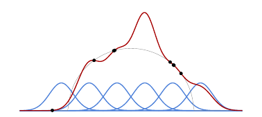

So, a large part of the art of applied machine learning is to design models that are not too flexible yet still able to fit the data. This is done by crafting the right *inductive bias* in a model, which means that its structure corresponds to the underlying structure of the data at hand.

Even though this classical perspective is relevant for reasonably-sized deep models, things get confusing with large ones that have a very large number of trainable parameters and extreme capacity yet still perform well on prediction. We will come back to this in § 3.6 and § 3.7.

*** 1.4 Categories of models
We can organize the use of machine learning models into three broad categories:

- *Regression* consists of predicting a continuous-valued vector $y\in\mathbb{R}^K$, for instance, a geometrical position of an object, given an input signal $X$. This is a multi-dimensional generalization of the setup in § 1.2. The training set is composed of pairs of an input signal and a ground-truth value.
- *Classification* aims at predicting a value from a finite set $\{1,\ldots,C\}$, for instance, the label $Y$ of an image $X$. As with regression, the training set is composed of pairs of input signal and ground-truth quantity, here a label from that set. The standard way of tackling this is to predict one score per potential class, such that the correct class has the maximum score.
- *Density modeling* has as its objective to model the probability density function of the data $\mu_X$ itself, for instance, images. In that case, the training set is composed of values $x_n$ without associated quantities to predict, and the trained model should allow for the evaluation of the probability density function, or sampling from the distribution, or both.

Both regression and classification are generally referred to as *supervised learning*, since the value to be predicted, which is required as a target during training, has to be provided, for instance, by human experts. On the contrary, density modeling is usually seen as *unsupervised learning*, since it is sufficient to take existing data without the need for producing an associated ground-truth.

These three categories are not disjoint; for instance, classification can be cast as class-score regression, or discrete sequence density modeling as iterated classification. Furthermore, they do not cover all cases. One may want to predict compounded quantities, or multiple classes, or model a density conditional on a signal.

** Chapter 2: Efficient Computation
From an implementation standpoint, deep learning is about executing heavy computations with large amounts of data. The Graphics Processing Units (GPUs) have been instrumental in the success of the field by allowing such computations to be run on affordable hardware.

The importance of their use, and the resulting technical constraints on the computations that can be done efficiently, force the research in the field to constantly balance mathematical soundness and implementability of novel methods.

*** 2.1 GPUs, TPUs, and batches
Graphics Processing Units (GPUs) were originally designed for real-time image synthesis, which requires highly parallel architectures that happen to be well suited for deep models. As their use for AI has increased, GPUs have been equipped with dedicated tensor cores, and deep-learning specialized chips such as Google’s Tensor Processing Units (TPUs) have been developed.

A GPU possesses several thousand parallel units and its own fast memory. The limiting factor is usually not the number of computing units, but the read-write operations to memory. The slowest link is between CPU memory and GPU memory, so data copying across devices should be avoided. Moreover, GPUs have multiple levels of cache memory, smaller but faster, and computation should be organized to avoid copies between caches.

This is achieved, in particular, by organizing computation in batches of samples that fit entirely in GPU memory and are processed in parallel. Proceeding by batches allows the model parameters to be copied only once instead of once per sample. In practice, a GPU processes a batch that fits in memory almost as quickly as it processes a single sample.

A standard GPU has a theoretical peak performance of $10^{13}$–$10^{14}$ floating-point operations (FLOPs) per second, and memory typically ranges from 8 to 80 gigabytes. Standard FP32 encoding uses 32 bits, but empirical results show that 16-bit encoding, or even less for some operands, need not degrade performance. We return to model size in § 3.7. (PDF pp. 21–22.)

*** 2.2 Tensors
GPUs and deep-learning frameworks such as PyTorch or JAX manipulate quantities as tensors: series of scalars arranged along several discrete axes, elements of $\mathbb{R}^{N_1\times\cdots\times N_D}$ that generalize vectors and matrices. Tensors represent input signals, trainable parameters, and intermediate quantities called *activations*.

A time series is naturally encoded as a $T\times D$ tensor, or, for historical reasons, as a $D\times T$ tensor, where $T$ is duration and $D$ is the feature dimension (the number of channels). A 2D-structured signal can be represented as a $D\times H\times W$ tensor. An RGB image has $D=3$, although the number of channels can grow to thousands in large models. For example, fifty RGB images of resolution $32\times24$ can be encoded as a $50\times3\times24\times32$ tensor.

Deep-learning libraries provide operations for linear algebra, reshaping and extraction, as well as specialized operations. Tensor shape is separated from coefficient storage layout, allowing many reshaping, transposing, and extraction operations without copying coefficients. In practice, computations can be decomposed into elementary tensor operations, avoiding non-parallel language-level loops and poor memory management. Tensor representation also enables hardware and software designers to optimize locality and block decomposability. (PDF pp. 23–24.)

** Chapter 3: Training
As introduced in § 1.1, training a model consists of minimizing a loss $\mathcal{L}(w)$ that reflects the performance of predictor $f(\cdot;w)$ on a training set $\mathcal{D}$. Since models are usually extremely complex, and performance is directly related to how well the loss is minimized, this is a key computational and mathematical challenge. (PDF p. 25.)

*** 3.1 Losses
The mean squared error from Equation 1.1 is a standard loss for predicting a continuous value. For density modeling, the standard loss is the negative log-likelihood of the data: if $f(x;w)$ is interpreted as a normalized log-probability or log-density, the loss is the negative sum of its values over training samples.

**** Cross-entropy
For classification, the model output is a vector with one component $f(x;w)_y$ per class $y$, interpreted as an unnormalized log-probability, or *logit*. For input $X=x$ and class $Y=y$, the estimated posterior is the softmax of the logits:

\begin{equation}
\hat{P}(Y=y\mid X=x)=\frac{\exp f(x;w)_y}{\sum_z\exp f(x;w)_z}.
\end{equation}

To maximize the probability of the true classes, training minimizes cross-entropy:

\begin{equation}
\mathcal{L}_{ce}(w)=-\frac{1}{N}\sum_{n=1}^{N}\log\hat{P}(Y=y_n\mid X=x_n)
=-\frac{1}{N}\sum_{n=1}^{N}\log\frac{\exp f(x_n;w)_{y_n}}{\sum_z\exp f(x_n;w)_z}.
\end{equation}

**** Contrastive loss
In some settings, continuous prediction is supervised by ranking constraints, as in metric learning. A sample $x_a$ should be closer to a same-class sample $x_b$ than to a different-class sample $x_c$. A standard contrastive loss over triplets with $y_a=y_b\ne y_c$ is

\begin{equation}
\max\left(0,1-f(x_a,x_c;w)+f(x_a,x_b;w)\right),
\end{equation}

which is positive unless $f(x_a,x_c;w)\ge 1+f(x_a,x_b;w)$.

**** Engineering the loss
The training loss is often a proxy for the quantity one ultimately wants to optimize. Cross-entropy, for instance, is standard for classification although the desired measure may be error rate, because error rate has no informative gradient. Additional loss terms can favor parameter configurations. *Weight decay* adds a term proportional to the sum of squared parameters; interpreted as a Gaussian Bayesian prior, it favors smaller values. This may degrade training-set performance while reducing the gap between performance on training and unseen data. (PDF pp. 26–29.)

*** 3.2 Autoregressive models
Autoregressive models are useful for discrete sequences in natural language processing and computer vision. They use the probability chain rule:

\begin{equation}
P(X_1=x_1,\ldots,X_T=x_T)=P(X_1=x_1)\prod_{t=2}^{T}P(X_t=x_t\mid X_1=x_1,\ldots,X_{t-1}=x_{t-1}).
\end{equation}

For tokens in a finite vocabulary $\{1,\ldots,K\}$, let $\emptyset$ denote an unknown quantity. A model $f:\{\emptyset,1,\ldots,K\}^T\to\mathbb{R}^K$ computes logits for the conditional distribution of the next token given the preceding tokens. Sampling tokens one at a time according to these conditional distributions yields a sequence from the joint distribution. Training minimizes the sum of per-token cross-entropies, equivalently maximizing the likelihood of the true tokens. Perplexity, the exponential of cross-entropy, is often monitored because it is more interpretable.

#+CAPTION: Figure 3.1. A causal autoregressive model lets input $x_t$ modulate logits $l_s$ only when $s>t$, permitting all training-time distributions to be computed in one pass; sampling remains sequential. (PDF p. 32.)
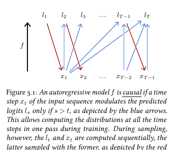

**** Causal models
The training procedure just described requires a different input for each $t$, and the bulk of the computation done for $t<t'$ is repeated for $t'$. This is extremely inefficient since $T$ is often of the order of hundreds or thousands. The standard strategy is to design a model $f$ that predicts all the vectors of logits $l_1,\ldots,l_T$ at once:

\begin{equation}
f:\{1,\ldots,K\}^T\to\mathbb{R}^{T\times K}.
\end{equation}

The model is constrained so that the logits at a time step depend only on preceding inputs, allowing training-time distributions for all time steps to be computed in one pass. During sampling, the inputs and logits are still computed sequentially. (PDF pp. 32–33.)

**** Tokenizer
Natural-language tokens may range from individual symbols to entire words. A separate algorithm, a *tokenizer*, converts to and from token representations. Byte Pair Encoding (BPE) [Sennrich et al., 2015] hierarchically merges character groups to produce fragments of varied lengths and similar frequencies, assigning tokens to frequent fragments and rare individual symbols. (PDF pp. 30–34.)

*** 3.3 Gradient descent
Except in special cases such as the linear regression of § 1.2, optimal parameters $w^*$ have no closed-form expression. Gradient descent initializes parameters at random $w_0$ and iteratively subtracts a fraction of the loss gradient:

\begin{equation}
w_{n+1}=w_n-\eta\left.\nabla\mathcal{L}\right|_w(w_n).\tag{3.1}
\end{equation}

This moves the estimate in a direction that locally decreases $\mathcal{L}(w)$ most rapidly. The positive hyperparameter $\eta$ is the *learning rate*: too small a value makes optimization slow and may trap it early, while too large a value may cause it to bounce around a minimum. The learning rate may depend on iteration number.

#+CAPTION: Figure 3.2. Gradient descent iteratively subtracts a fraction of the gradient, following a steepest-descent trajectory across loss level curves. (PDF p. 36.)
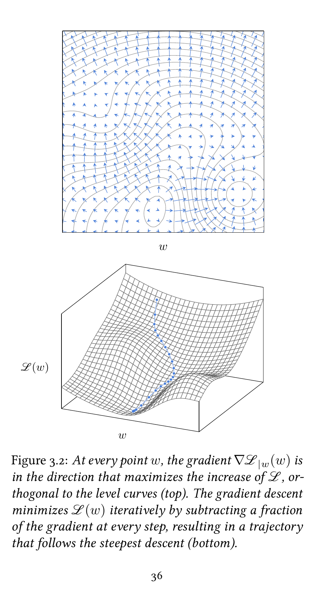

**** Stochastic Gradient Descent
For losses expressed as averages of per-sample losses, $\mathcal{L}(w)=\frac{1}{N}\sum_{n=1}^{N}\ell_n(w)$, the gradient is

\begin{equation}
\left.\nabla\mathcal{L}\right|_w(w)=\frac{1}{N}\sum_{n=1}^{N}\left.\nabla\ell_n\right|_w(w).\tag{3.2}
\end{equation}

Computing the full sum is costly. Under reasonable assumptions such as shuffled samples, a partial sum is an unbiased but noisy estimate, allowing more gradient steps for the same computation. The standard approach partitions $\mathcal{D}$ into memory-sized batches and updates from each batch: *mini-batch stochastic gradient descent* (SGD). Training typically takes millions of steps. Adam [Kingma and Ba, 2014], a popular variant, maintains running estimates of each gradient component’s mean and variance and normalizes them to avoid scaling issues and unequal training speeds. (PDF pp. 35–39.)

*** 3.4 Backpropagation
For a loss $\ell=L(f(x;w);y)$, gradient descent requires computing $\nabla_w\ell$. The chain rule applied to the standard tensor operations composing $f$ and $L$ yields the required expression. Consider $f=f^{(D)}\circ f^{(D-1)}\circ\cdots\circ f^{(1)}$, with intermediate activations

\begin{equation}
x^{(0)}=x,\qquad x^{(d)}=f^{(d)}(x^{(d-1)};w_d).
\end{equation}

The forward pass computes these activations in order. The backward pass recursively propagates loss gradients through the layer Jacobians, starting at the output, and computes gradients with respect to each layer’s parameters. This procedure is *backpropagation*. Deep-learning frameworks build the required operation sequence automatically; autograd [Baydin et al., 2015] tracks tensor operations to compute gradients.

#+CAPTION: Figure 3.3. The forward pass computes layer outputs; the backward pass propagates gradients through Jacobians to activations and parameters. (PDF p. 40.)
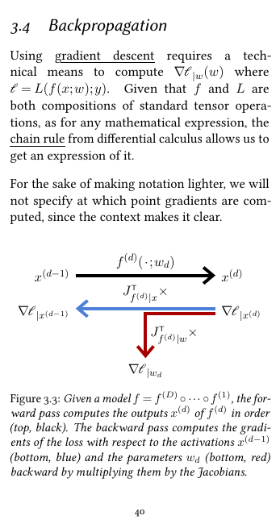

**** Resource usage
Linear operations dominate computation: each requires one matrix product for the forward pass and two for backward Jacobian products, making the backward pass roughly twice as costly. Inference memory is roughly that of the most demanding layer. Training must retain forward activations for the backward pass, so memory grows with depth. Reversible layers [Gomez et al., 2017] and checkpointing [Chen et al., 2016] trade computation for memory by recomputing some activations.

**** Vanishing gradient
Gradients may be scaled multiplicatively as they propagate through layers, decreasing or increasing exponentially. Gradient norm clipping rescales gradients above a threshold to prevent explosion [Pascanu et al., 2013]. Exponential decrease is the *vanishing gradient* problem, which can impede training or cause model parts to update at different speeds [Glorot and Bengio, 2010]. Model-design techniques address this by making networks easier to optimize. (PDF pp. 40–44.)

*** 3.5 The value of depth
Useful models are generally compositions of long series of mappings. Training co-adapts these mappings even though gradient descent is gradual and local. For illustration, an eight-layer model from $\mathbb{R}^2$ to $\mathbb{R}^2$, with each layer multiplying by a $2\times2$ matrix and applying componentwise Tanh, followed by a linear classifier, can deform a toy binary-classification space until the data are linearly separable before the final affine operation.

#+CAPTION: Figure 3.4. Deformation of the input space after successive layers, ending with a linear decision boundary. (PDF p. 46.)
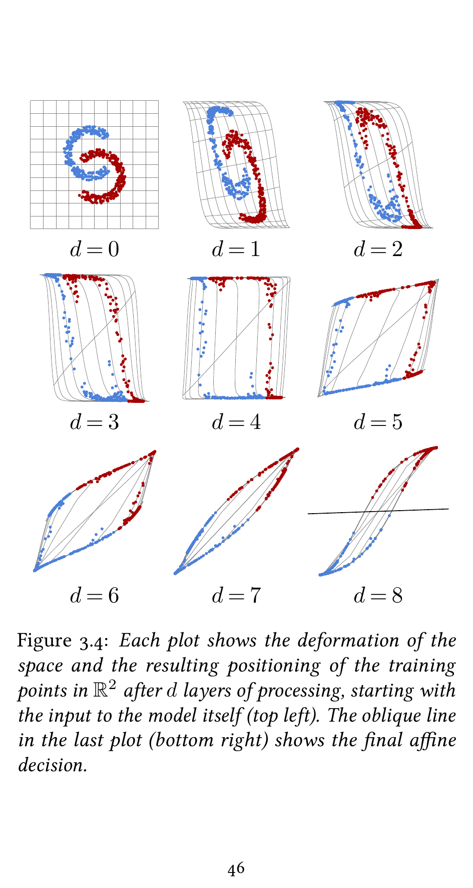

This 2D illustration is simplified; real models use high-dimensional representations, which provide degrees of freedom that facilitate optimization. Empirically, state-of-the-art performance across domains requires models with tens of layers, such as residual networks and transformers. For fixed computation or parameter count, theory shows that increasing depth can increase mapping complexity [Telgarsky, 2016]. (PDF pp. 45–47.)

*** 3.6 Training protocols
Training protocols must use computation and data effectively and ensure performance on new data. Since training performance can be misleading, a *training set* optimizes parameters and a disjoint *test set* evaluates the trained model. When adapting hyperparameters such as architecture, learning rate, and regularization, a separate *validation set* is used to select configurations.

Training is usually decomposed into *epochs*, each passing through all training examples once. Training loss typically decreases, while validation loss may reach a minimum and then increase as overfitting begins. Overfitting was introduced in § 1.3 and is illustrated in Figure 3.5.

#+CAPTION: Figure 3.5. Training loss decreases as optimization proceeds; rising validation loss signals overfitting. (PDF p. 49.)
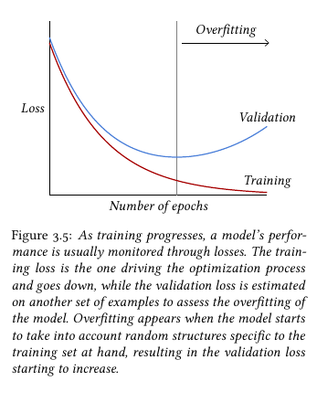

Paradoxically, although they should suffer from severe overfitting due to their capacity, large models usually continue to improve as training progresses. This may be because the model's inductive bias becomes the main driver of optimization when performance is near perfect [Belkin et al., 2018]. A learning-rate schedule specifies the rate at each iteration: it is generally large initially and then reduced to avoid bouncing around minima. Training very large models may take months on thousands of GPUs and cost millions of dollars, involving manual interventions informed by loss dynamics. (PDF pp. 49–50.)

**** Fine-tuning
An already trained model can be adapted to a *downstream task* when its learned statistical structure provides useful inductive bias or when reusing it reduces training cost. *Fine-tuning* is standard training for the new task starting from the pretrained parameters rather than random initialization. It is common in computer vision, using models pretrained on ImageNet [Deng et al., 2009], and in adapting generative pretrained language models into assistant-like systems. Chapter 8 returns to resource constraints in inference and fine-tuning. (PDF pp. 48–51.)

*** 3.7 The benefits of scale
Empirical scaling laws show that test loss improves with more data when model size increases correspondingly [Kaplan et al., 2020]. Deep models can be scaled by increasing layer count or feature dimensions; distributed computation and stochastic gradient descent allow training on datasets far larger than device memory.

#+CAPTION: Figure 3.6. Language-model test loss versus computation, dataset size, and parameter count [Kaplan et al., 2020]. (PDF p. 53.)
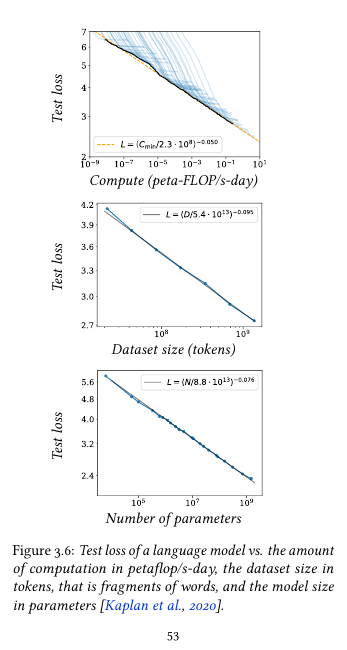

Typical vision models have 10–100 million trainable parameters and require $10^{18}$–$10^{19}$ FLOPs for training. Language models range from 100 million to hundreds of billions of parameters and require $10^{20}$–$10^{23}$ FLOPs [Devlin et al., 2018; Brown et al., 2020; Chowdhery et al., 2022; Sevilla et al., 2022], requiring machines with multiple high-end GPUs.

#+CAPTION: Table 3.1. Examples of publicly available datasets; estimated equivalent book counts use 250 pages of 2,000 characters per book. (PDF p. 54.)
| Dataset      | Year | Images | Size  |
|--------------+------+--------+-------|
| ImageNet     | 2012 | 1.2M   | 150Gb |
| Cityscape    | 2016 | 25K    | 60Gb  |
| LAION-5B     | 2022 | 5.8B   | 240Tb |

| Dataset      | Year | Books | Size  |
|--------------+------+-------+-------|
| WMT-18-de-en | 2018 | 14M   | 8Gb   |
| The Pile     | 2020 | 1.6B  | 825Gb |
| OSCAR        | 2020 | 12B   | 6Tb   |

Large-model training is not feasible with detailed ground-truth datasets, which are costly and moderate in size. Instead, it uses automatically produced, minimally curated data from the internet, potentially combining modalities such as text and images or sound and video images. As of 2024, the most powerful models are Large Language Models trained on extremely large text datasets. (PDF pp. 52–56.)

#+CAPTION: Figure 3.7. Training costs of landmark models; dashed lines indicate estimated energy consumption on A100 SXM GPUs in 16-bit precision. (PDF p. 55.)
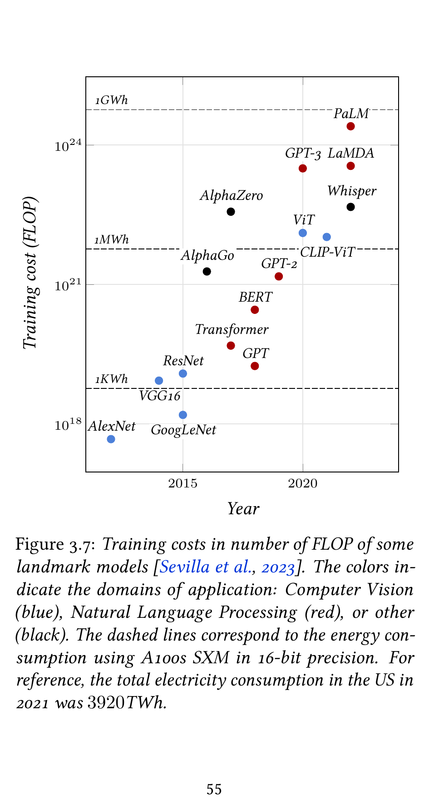

*** 3.8 Large-Scale Parallel Training
Very large models require more memory and computation than one GPU provides, so training is distributed across devices.

**** Distributed Data Parallelism
In Distributed Data Parallelism (DDP), the entire model is replicated on each GPU, and each replica processes a different batch portion. During backpropagation, GPUs communicate gradients so replicas remain synchronized. Effective batch size scales with device count, but the full model must fit on every device.

**** Fully Sharded Data Parallelism
Fully Sharded Data Parallelism (FSDP) distributes trainable parameters across devices [Zhao et al., 2023], with each device storing only shards of parameters, gradients, and optimizer states. Shards are gathered temporarily when needed and then released. This increases the maximum model size roughly linearly with device count, at the cost of more inter-GPU communication, which can overlap computation.

**** Pipeline and tensor parallelism
Pipeline parallelism dispatches entire layers across GPUs, trading communication of parameters for communication of activations. Tensor parallelism is useful when an individual layer cannot fit on one device; it decomposes matrix products into block products whose intermediate results are combined into the full product. (PDF pp. 57–58.)

* Part II: Deep Models
** Chapter 4: Model Components
A deep model is a complex tensor computation decomposable into standard mathematical operations. The field has developed high-level modules that make it easier to design effective models. Deeper compositions are challenging to train because of vanishing gradients, but several technical contributions mitigate this problem. (PDF pp. 59–60.)

*** 4.1 The notion of layer
Layers are standard, compounded tensor operations identified as generic and efficient. They often contain trainable parameters and provide a convenient granularity for describing models. Modern models may be complex graphs with parallel pathways. In diagrams, boxes denote operators, darker boxes indicate parameters, blue labels show non-default hyperparameters, dashed frames and multiplicative factors indicate repeated groups, and output dimensions may be labeled. (PDF pp. 61–62.)

*** 4.2 Linear layers
Linear layers, the largest contributors to computation and parameter count, implement affine operations (a linear map plus bias). A fully connected layer has weight matrix $W\in\mathbb{R}^{D'\times D}$ and bias $b\in\mathbb{R}^{D'}$; for input shape $D_1\times\cdots\times D_K\times D$, it returns $Y$ of shape $D_1\times\cdots\times D_K\times D'$ with

\begin{equation}
Y[d_1,\ldots,d_K]=WX[d_1,\ldots,d_K]+b.
\end{equation}

Affine maps support projections and filtering, and dot products can be interpreted as similarity scores between queries and keys. Initialization must scale random parameters according to input dimension to control activation variance and avoid pathological gradients.

Convolutions apply the same local affine operator throughout a signal, leveraging local correlation and translation stationarity. A 1D convolution maps each input sub-tensor of size $D\times K$ through $\phi(\cdot;w):\mathbb{R}^{D\times K}\to\mathbb{R}^{D'\times1}$, producing an output of size $D'\times(T-K+1)$ without padding. A 2D convolution similarly applies a $D\times K\times L$ filter to a $D\times H\times W$ tensor. Shared filters and bias are trainable parameters; convolution is translation equivariant.

#+CAPTION: Figure 4.1. 1D convolution and transposed convolution, applying shared affine maps over local positions. (PDF p. 65.)
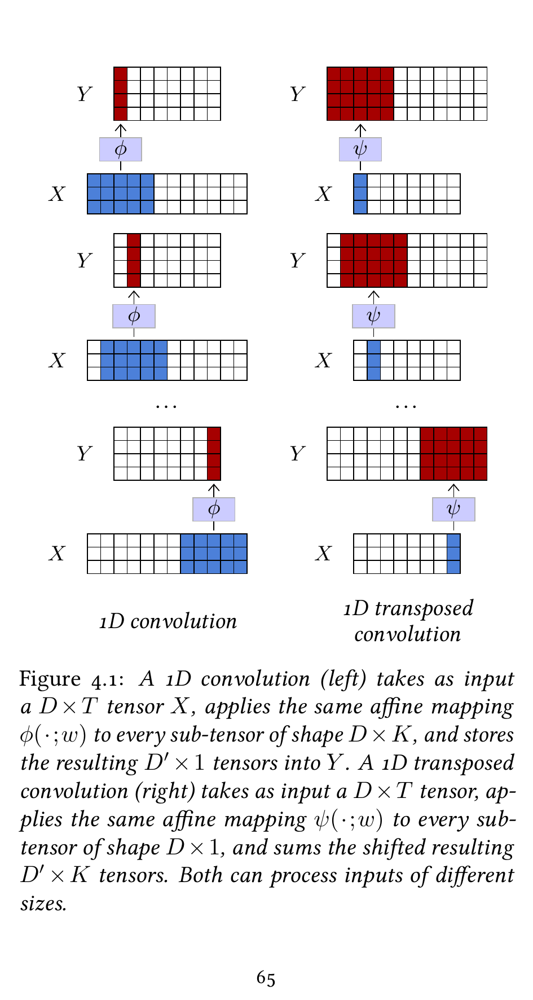

#+CAPTION: Figure 4.2. 2D convolution and transposed convolution over local spatial patches. (PDF p. 66.)
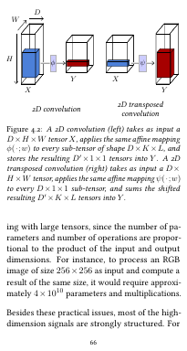

For large tensors, fully connected transformations are impractical: parameter and operation counts scale with the product of input and output dimensions. Mapping a $256\times256$ RGB image to an output of the same size would require about $4\times10^{10}$ parameters and multiplications. High-dimensional signals are also strongly structured, so local convolutions exploit that structure instead of treating every input-output pair independently. (PDF p. 66.)

Convolutions have hyperparameters padding $p$, stride $s$, and dilation $d$. Without padding or dilation, a 1D input of length $T$ and kernel $K$ with stride $S$ yields $T'=(T-K)/S+1$. The *receptive field* is the portion of the input that modulates an activation; a feature map is the spatial slice for one channel. Convolutions combine information and often reduce spatial size while increasing channels. Transposed convolutions sum shifted local affine results, increasing signal size and serving as a synthesis-like operation.

#+CAPTION: Figure 4.3. Convolution padding, stride, and dilation. (PDF p. 67.)
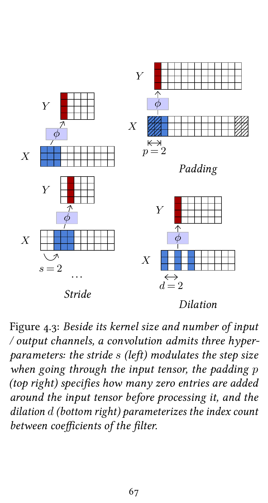

#+CAPTION: Figure 4.4. Receptive field growth across convolutional layers. (PDF p. 70.)
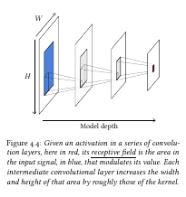

**** 4.3 Activation functions
Compositions of linear operators remain linear, so networks require nonlinear activation functions, which apply a scalar mapping independently to each tensor component. ReLU is $\operatorname{relu}(x)=\max(0,x)$. Despite its nondifferentiability at zero and zero gradient for negative values, initialization and normalization make gradients informative in practice. Tanh saturates at both extremes and can aggravate vanishing gradients. Leaky ReLU uses $ax$ for $x<0$ and $x$ otherwise; GELU is $\operatorname{gelu}(x)=xP(Z\le x)$ for $Z\sim\mathcal{N}(0,1)$, a smooth ReLU-like function. The choice is generally empirical.

#+CAPTION: Figure 4.5. Tanh, ReLU, leaky ReLU, and GELU activation functions. (PDF p. 74.)
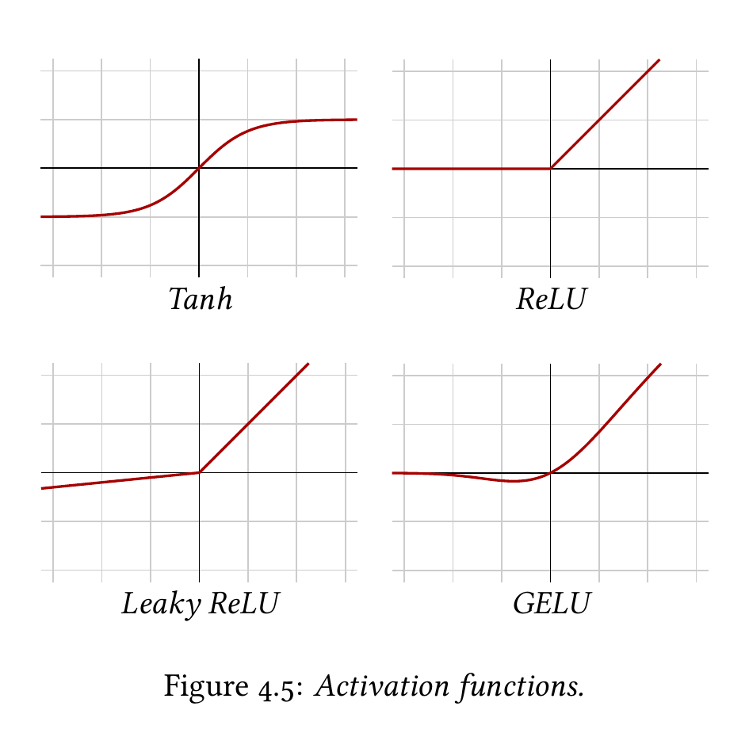

Before ReLU became common, the hyperbolic tangent was a standard activation; it saturates exponentially on both sides and can worsen vanishing gradients. Leaky ReLU retains a small positive slope for negative inputs, while GELU provides a smooth ReLU-like alternative. (PDF p. 74.)

**** 4.4 Pooling
Pooling combines activations to summarize information and reduce signal size. Max pooling takes the maximum per channel over non-overlapping spatial windows; its default stride equals the kernel size. Padding, stride, and dilation follow convolution conventions. Max pooling can be viewed as a logical disjunction over local feature-presence scores and loses precise location. Average pooling computes the window mean and is linear.

#+CAPTION: Figure 4.6. 1D max pooling over non-overlapping windows. (PDF p. 77.)
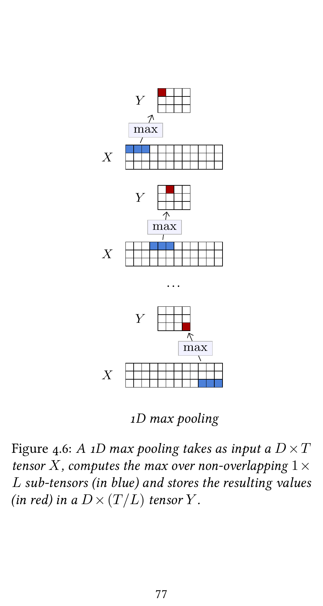

**** 4.5 Dropout
Dropout [Srivastava et al., 2014] has no trainable parameters and uses hyperparameter $p$. During training it independently zeros activations with probability $p$ and scales retained activations by $1/(1-p)$ to preserve their expected value; during testing it is the identity. It discourages reliance on groups of co-adapted activations and can be viewed as noise injection. For 2D signals, correlated neighboring activations make elementwise dropout ineffective, so entire channels are dropped instead. Dropout can also support uncertainty estimation [Gal and Ghahramani, 2015].

#+CAPTION: Figure 4.7. Standard dropout randomly removes individual activations during training. (PDF p. 80.)
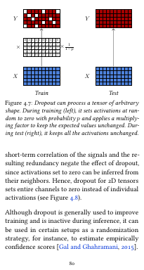

For 2D signals, short-range correlation makes elementwise dropout less effective because a zeroed activation can be inferred from its neighbors; channel-wise dropout therefore zeros whole channels. Although dropout is usually inactive at inference, repeated stochastic passes can be used to estimate confidence scores. (PDF p. 80.)

#+CAPTION: Figure 4.8. For correlated 2D signals, dropout removes whole channels. (PDF p. 81.)
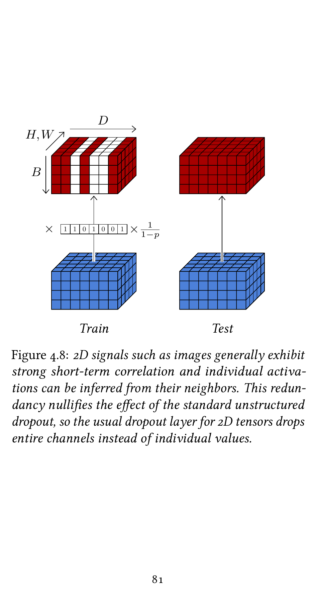

**** 4.6 Normalizing layers
Normalization layers constrain empirical means and variances of activation groups. Batch normalization [Ioffe and Szegedy, 2015] operates across a batch of $B$ samples with $D$ components and learned per-component parameters $\beta_d,\gamma_d$. It computes

\begin{equation}
\hat{m}_d=\frac{1}{B}\sum_{b=1}^{B}x_{b,d},\qquad
\hat{v}_d=\frac{1}{B}\sum_{b=1}^{B}(x_{b,d}-\hat{m}_d)^2,
\end{equation}

then normalizes and transforms each component:

\begin{equation}
z_{b,d}=\frac{x_{b,d}-\hat{m}_d}{\sqrt{\hat{v}_d+\epsilon}},\qquad y_{b,d}=\gamma_d z_{b,d}+\beta_d.
\end{equation}

At test time, moving-average statistics from training are used, yielding a fixed affine map per component. For image tensors, statistics are computed over batch and spatial positions, while learned scale and shift remain per-channel. Layer normalization [Ba et al., 2016] instead normalizes each sample across its components and is the same at training and test time.

#+CAPTION: Figure 4.9. Batch normalization aggregates across the batch; layer normalization aggregates within each sample. (PDF p. 83.)
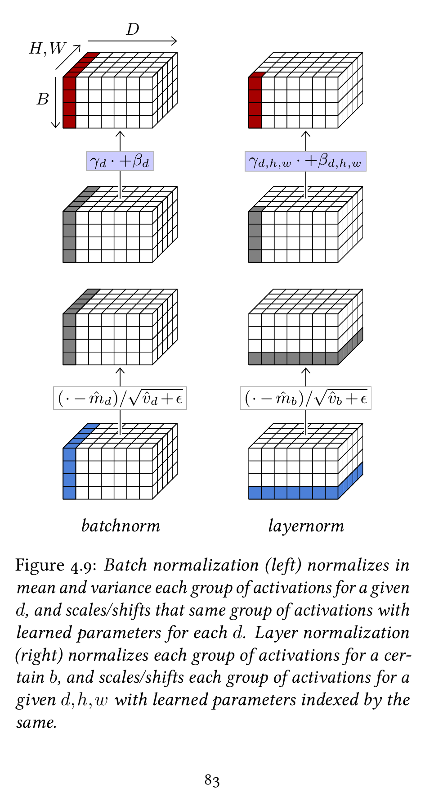

**** 4.7 Skip connections
Skip connections transport a layer output unchanged to a later layer, bypassing intermediate processing; the signal may be concatenated or added. Residual connections add the original signal to a transformed signal, usually across a few layers. These paths preserve gradient flow when intermediate operations suppress it and enable very deep networks, including ResNets and Transformers. Skip connections also support multi-scale reasoning and can make learning a residual improvement easier than learning a full update.

#+CAPTION: Figure 4.10. Skip connections across layers, including multi-scale and residual additions. (PDF p. 88.)
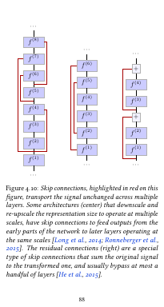

**** 4.8 Attention layers
Attention combines information from distant positions. Given queries $Q$ of size $N_Q\times D_{QK}$, keys $K$ of size $N_{KV}\times D_{QK}$, and values $V$ of size $N_{KV}\times D_V$, it computes $Y=\operatorname{att}(Q,K,V)$ of size $N_Q\times D_V$. For query $q$ and key $k$, scaled dot-product attention is

\begin{equation}
A_{q,k}=\frac{\exp\left(Q_q\cdot K_k/\sqrt{D_{QK}}\right)}{\sum_l\exp\left(Q_q\cdot K_l/\sqrt{D_{QK}}\right)},\qquad
Y_q=\sum_k A_{q,k}V_k.
\end{equation}

The scale $1/\sqrt{D_{QK}}$ controls score range. In matrix form, $\operatorname{att}(Q,K,V)=\operatorname{softargmax}(QK^T/\sqrt{D_{QK}})V$. A Boolean mask can restrict allowed positions; a causal mask has ones on and below the diagonal and zeros above, preventing access to future positions. Dropout may be applied to attention weights. Dense attention costs quadratically in sequence length, motivating sparse and linearized variants.

**** Multi-head Attention
Multi-head attention uses $H$ learned query, key, and value projections, with matrices $W^Q,W^K\in\mathbb{R}^{H\times D\times D_{QK}}$ and $W^V\in\mathbb{R}^{H\times D\times D_V}$. For each head $h$, $Y_h=\operatorname{att}(X_QW_h^Q,X_KW_h^K,X_VW_h^V)$. The head outputs are concatenated and projected by $W^O\in\mathbb{R}^{HD_V\times D}$:

\begin{equation}
Y=(Y_1\mid\cdots\mid Y_H)W^O.
\end{equation}

Self-attention uses the same input sequence for queries, keys, and values; cross-attention uses one sequence for queries and another for keys and values. Without masking, attention is permutation-invariant to key/value order and permutation-equivariant to query order. (PDF pp. 95–97.)

#+CAPTION: Figure 4.13. Multi-head attention projects inputs into multiple query/key/value heads, concatenates their outputs, and applies a final projection. (PDF p. 95.)
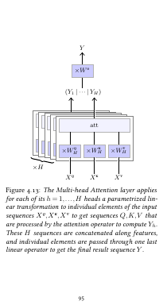

#+CAPTION: Figure 4.11. Attention matches queries to keys and averages corresponding values. (PDF p. 91.)
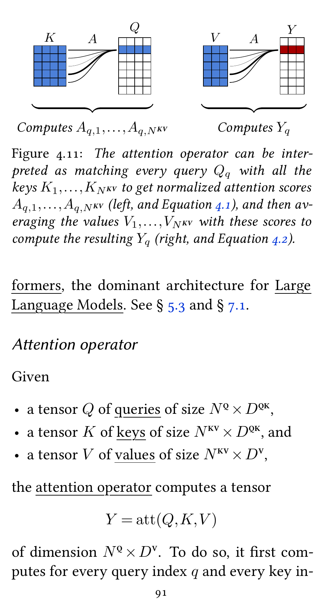

For each query, attention first compares it with all keys to obtain normalized scores, then averages the corresponding values using those scores. In general, $Q$ has shape $N^Q\times D^{QK}$, while $K$ and $V$ have shapes $N^{KV}\times D^{QK}$ and $N^{KV}\times D^V$; the result has shape $N^Q\times D^V$. (PDF p. 91.)

#+CAPTION: Figure 4.12. Scaled attention with optional masking and dropout. (PDF p. 93.)
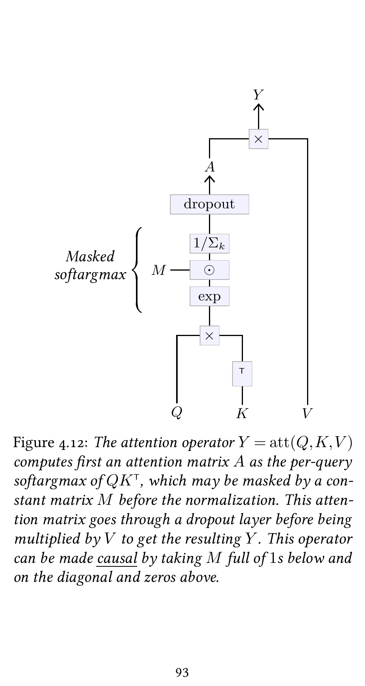

**** 4.9 Token embedding
An embedding layer maps discrete tokens to vectors through a lookup table. With $N$ possible tokens and embedding dimension $D$, its trainable matrix is $M\in\mathbb{R}^{N\times D}$; an integer input tensor is replaced by the corresponding rows of $M$, appending a dimension of size $D$. (PDF p. 98.)

**** 4.10 Positional encoding
Fully connected layers depend on input and output positions, but convolution and multi-head attention are insensitive to absolute position, which provides useful invariance for stationary signals. Where absolute or relative position matters, a positional feature vector is added to or concatenated with each representation. It may be learned or analytic. The original Transformer uses sinusoidal encodings, for position $t$, feature $d$, and $T=10^4$:

\begin{equation}
\operatorname{pos\text{-}enc}[t,d]=
\begin{cases}
\sin\left(t/T^{d/D}\right),&d\text{ even},\\
\cos\left(t/T^{(d-1)/D}\right),&d\text{ odd}.
\end{cases}
\end{equation}

(PDF pp. 99–100.)

** Chapter 5: Architectures
Deep-learning architectures trade off training ease, prediction accuracy, memory footprint, computational cost, and scalability. (PDF p. 101.)

*** 5.1 Multi-Layer Perceptrons
A Multi-Layer Perceptron (MLP) is a succession of fully connected layers separated by activation functions. Its hidden-layer count conventionally excludes the final linear layer. The universal approximation theorem [Cybenko, 1989] states that, with continuous non-polynomial activation and sufficiently wide hidden representation, a one-hidden-layer MLP can approximate any continuous function uniformly on a compact domain. MLPs remain useful when input dimension is moderate.

#+CAPTION: Figure 5.1. An MLP with three fully connected layers, dimensions 25, 10, and 2, and ReLU activations between the first two. (PDF p. 102.)
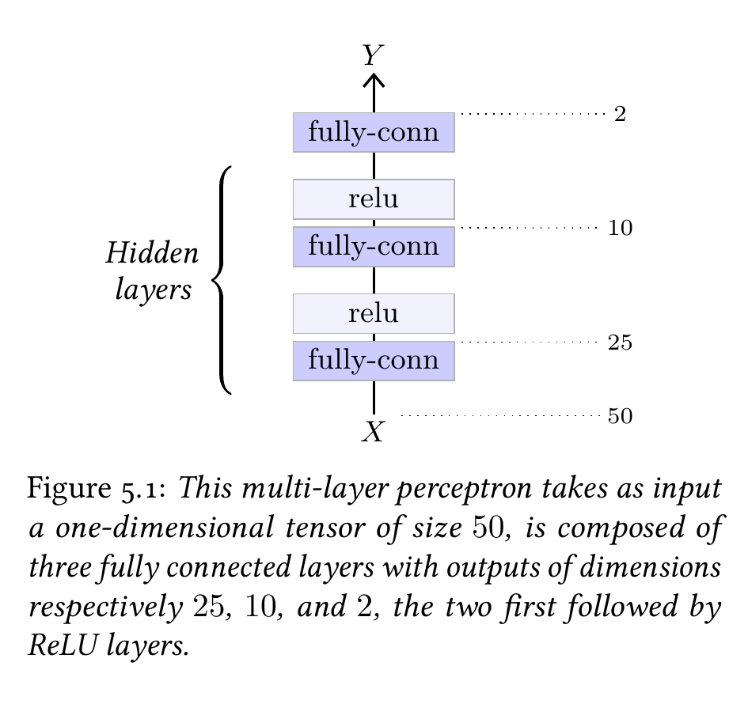

The universal approximation theorem [Cybenko, 1989] states that a one-hidden-layer MLP with a continuous activation function can uniformly approximate any continuous function on a compact domain when its hidden layer is sufficiently wide. (PDF p. 102.)

*** 5.2 Convolutional networks
Convolutional networks combine convolutional layers to reduce signal size before fully connected classification, or to produce a large 2D output. The LeNet image classifier combines convolution and max pooling as a feature extractor, then fully connected layers for classification; AlexNet and VGG are larger descendants.

#+CAPTION: Figure 5.2. LeNet-like classifier for 28×28 grayscale handwritten digits. (PDF p. 105.)
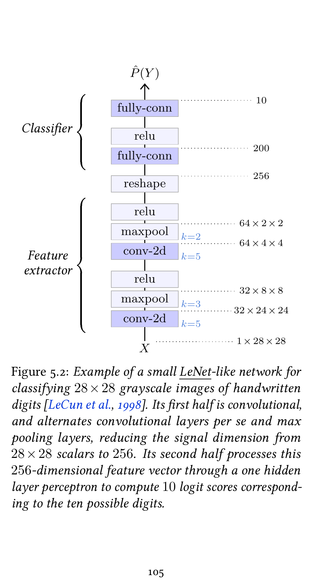

Residual networks (ResNets) [He et al., 2015] use residual connections to mitigate vanishing gradients and support hundreds of layers. A residual block combines convolutions, batch normalization, and ReLU within a skip connection. Bottleneck blocks reduce channels with a $1\times1$ convolution, process spatially with a $3\times3$ convolution, then expand channels with another $1\times1$ convolution. Downscaling blocks alter tensor shape with a strided projection on the skip path.

#+CAPTION: Figure 5.3. Residual block with convolution, batch normalization, ReLU, and shortcut. (PDF p. 106.)
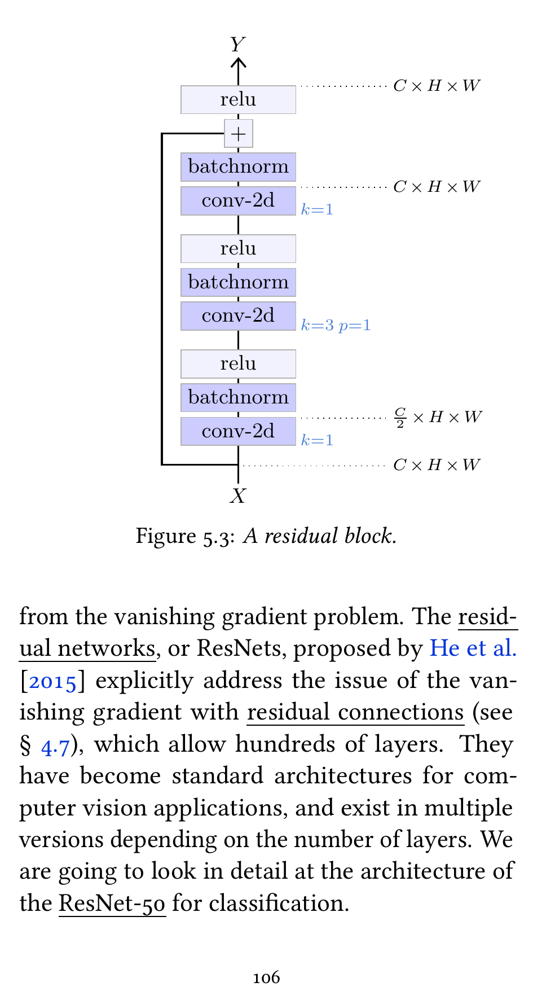

Residual networks (ResNets), introduced to address vanishing gradients, use residual connections to support networks hundreds of layers deep. They became a standard family of computer-vision architectures, available in variants with different depths; the following discussion uses ResNet-50 for classification. (PDF p. 106.)

#+CAPTION: Figure 5.4. Downscaling residual block, with stride controlling spatial reduction. (PDF p. 107.)
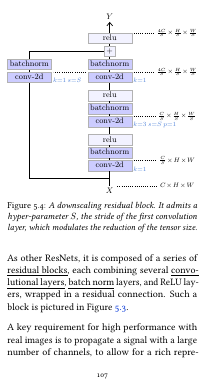

In a downscaling residual block, the first convolution uses stride $S$ to reduce the spatial dimensions, and a strided projection on the skip path matches the changed tensor shape. ResNets build stages from these blocks, combining convolution, batch normalization, and ReLU inside residual connections. (PDF p. 107.)

ResNet-50 begins with a $7\times7$ convolution and max pooling, then four residual sections. Later sections halve spatial dimensions and increase channels; average pooling converts the final $2048\times7\times7$ activation to 2048 features, followed by a fully connected classifier. (PDF pp. 108–110.)

#+CAPTION: Figure 5.5. ResNet-50 architecture for 1000-class image classification. (PDF p. 108.)
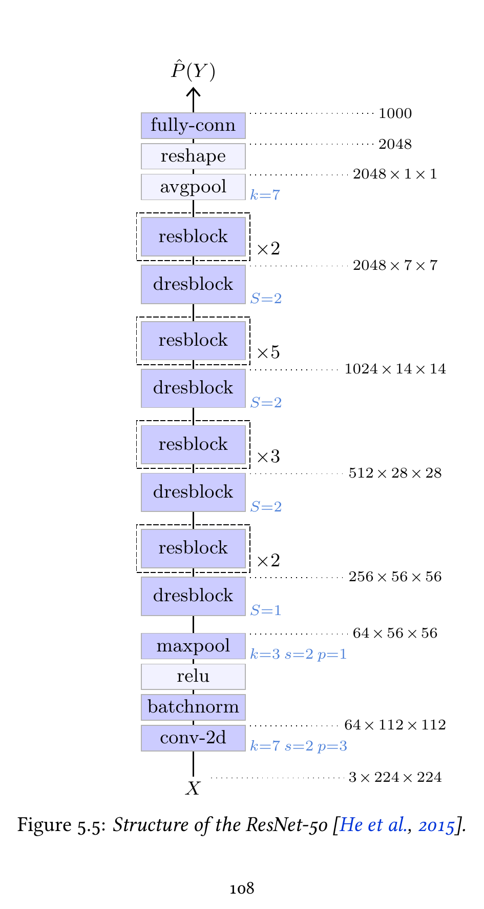

*** 5.3 Attention models
Transformers [Vaswani et al., 2017] are a dominant attention-based architecture, especially in language processing. Their feed-forward block is a one-hidden-layer MLP applied independently at each position; self-attention aggregates information across positions; cross-attention obtains queries from one sequence and keys/values from another. These blocks are combined with residual connections and layer normalization.

#+CAPTION: Figure 5.6. Feed-forward, self-attention, and cross-attention blocks. (PDF p. 112.)
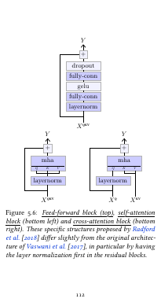

The original encoder-decoder Transformer embeds input tokens, adds positional encodings, and applies self-attention blocks to produce a refined representation. Its decoder embeds generated tokens and alternates causal self-attention with cross-attention over encoder outputs to predict the next token. Causality enables full-sequence training with summed cross-entropy.

#+CAPTION: Figure 5.7. Original encoder-decoder Transformer for sequence-to-sequence translation. (PDF p. 113.)
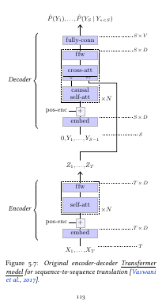

The Generative Pre-trained Transformer (GPT) is a pure autoregressive model built from causal self-attention blocks; it scales to hundreds of billions of parameters. The Vision Transformer (ViT) divides an image into $M$ patches of size $P\times P$, flattens each into $3P^2$ values, projects them to dimension $D$, and prepends a learned classification vector $E_0$. Self-attention processes the resulting $(M+1)\times D$ sequence; a readout MLP maps the output corresponding to $E_0$ to class logits. This special readout is the CLS token.

#+CAPTION: Figure 5.8. GPT model, using causal self-attention to predict each next token. (PDF p. 115.)
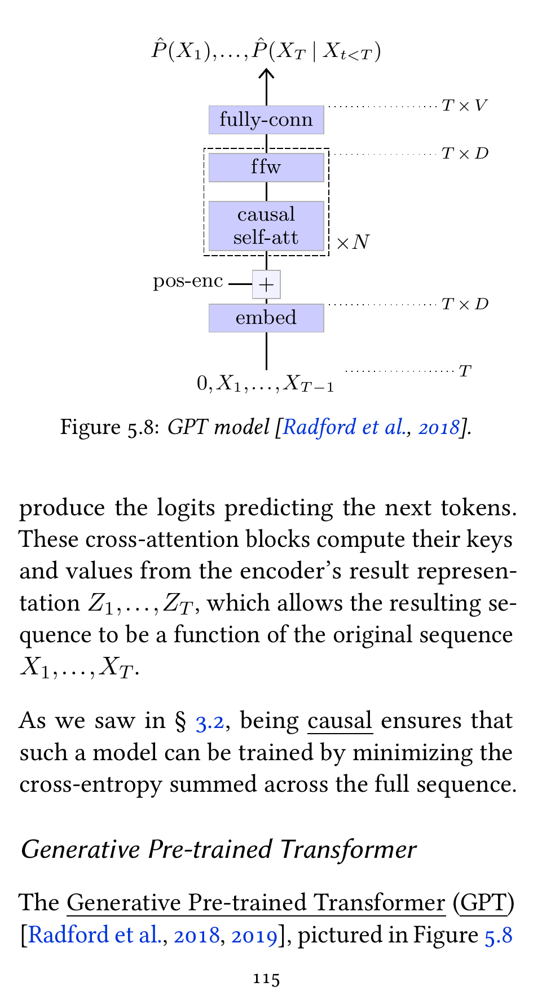

GPT, the Generative Pre-trained Transformer [Radford et al., 2018, 2019], is an autoregressive model: token embeddings and positional encodings feed repeated causal self-attention and feed-forward blocks, which produce logits for the next token at each position. (PDF p. 115.)

#+CAPTION: Figure 5.9. Vision Transformer patch embedding, attention stack, and CLS-token readout. (PDF p. 117.)
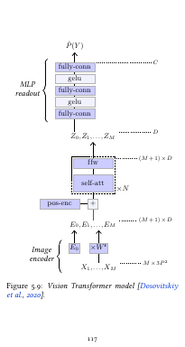

* Part III: Applications
** Chapter 6: Prediction
A first category of applications, such as face recognition, sentiment analysis, object detection, or speech recognition, predicts an unknown value from an available signal. (PDF pp. 119–120.)

*** 6.1 Image denoising
A denoising autoencoder takes a degraded signal $\tilde{X}$ as input and estimates the original $X$. For images it may be a convolutional network with skip connections that combine representations at the same resolution and attention layers that incorporate distant information. Training uses paired clean and degraded samples, with degradations captured in poor conditions or generated algorithmically. With pixelwise MSE, the model estimates $\mathbb{E}[X\mid\tilde{X}]$, which can produce blurry averages when the original is not determined by the degraded input. (PDF pp. 121–122.)

*** 6.2 Image classification
Image classification predicts one of a finite set of classes from an image. Standard convolutional or attention models produce one logit per class and are trained with cross-entropy. Data augmentation applies label-preserving random transformations such as cropping, scaling, mirroring, or color changes. (PDF p. 123.)

*** 6.3 Object detection
Object detection predicts classes and locations of objects, represented by bounding boxes $(x_1,y_1,x_2,y_2)$. Convolutional detectors such as SSD generate representations at multiple spatial resolutions. At each scale and location, the model predicts bounding-box coordinates and class logits, including a “no object” class. SSD uses multiple boxes with preset aspect ratios. Training matches ground-truth boxes to scale/location/anchor predictions and combines classification cross-entropy with box regression loss; unmatched locations are trained as “no object.” Pretraining on a large classification dataset helps compensate for costly detection labels. (PDF pp. 124–128.)

#+CAPTION: Figure 6.1. A convolutional object detector produces multi-scale image representations and bounding-box predictions. (PDF p. 125.)
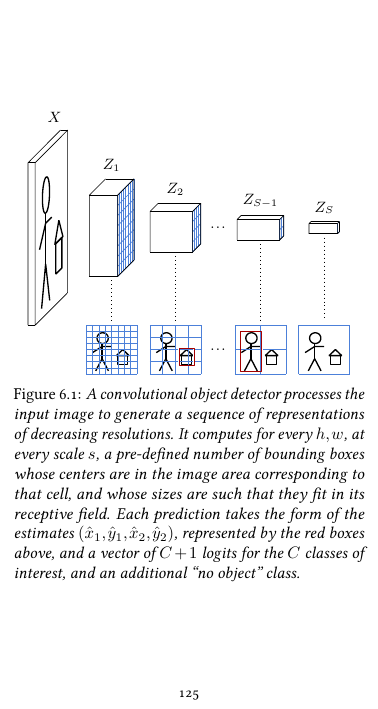

#+CAPTION: Figure 6.2. Examples of object detection with the Single-Shot Detector. (PDF p. 126.)
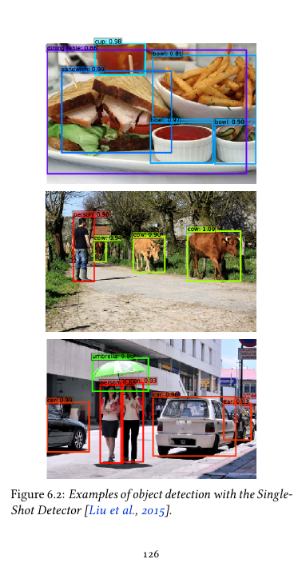

*** 6.4 Semantic segmentation
Semantic segmentation predicts the class of every pixel. A convolutional network generates per-pixel logits; multi-scale processing captures objects of different sizes by downscaling to enlarge receptive fields and then upscaling. Skip connections or parallel multi-scale pathways preserve fine detail. (PDF pp. 129–131.)

#+CAPTION: Figure 6.3. Semantic segmentation results with the Pyramid Scene Parsing Network. (PDF p. 130.)
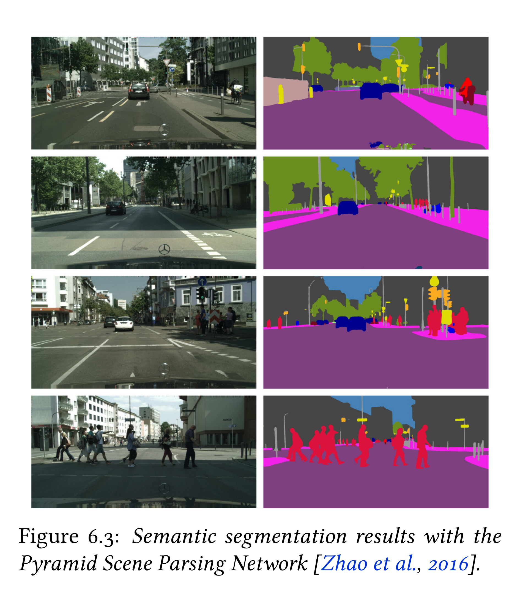

Models that use multi-scale pathways in parallel, after a convolutional backbone, concatenate the resulting multi-scale representation after upscaling, before making the final per-pixel prediction [Zhao et al., 2016]. Training uses cross-entropy summed over all pixels. As in object detection, training can start from a network pretrained on a large-scale image-classification dataset to compensate for the limited availability of segmentation ground truth. (PDF pp. 130–131.)

*** 6.5 Speech recognition
Speech recognition converts sound into words. One approach converts audio to a spectrogram, a sequence of frequency-band energies, processes it with 1D convolutions and a Transformer encoder, then uses a decoder to generate text tokens. A shared model can handle transcription, translation, and non-speech sound detection. (PDF pp. 132–133.)

*** 6.6 Text-image representations
Contrastive Language-Image Pre-training (CLIP) [Radford et al., 2021] trains image and text encoders on 400 million web image-text pairs. In a minibatch of $N$ pairs, it computes cosine similarities $l_{m,n}=f(i_m)\cdot g(t_n)$ for all image/text combinations, producing an $N\times N$ score matrix. Cross-entropy trains each row and column to match paired items. At inference, an image can be classified zero-shot by comparing its embedding with embeddings of candidate class descriptions. (PDF pp. 134–136.)

#+CAPTION: Figure 6.4. CLIP enables zero-shot prediction by matching image and class-description embeddings. (PDF p. 136.)
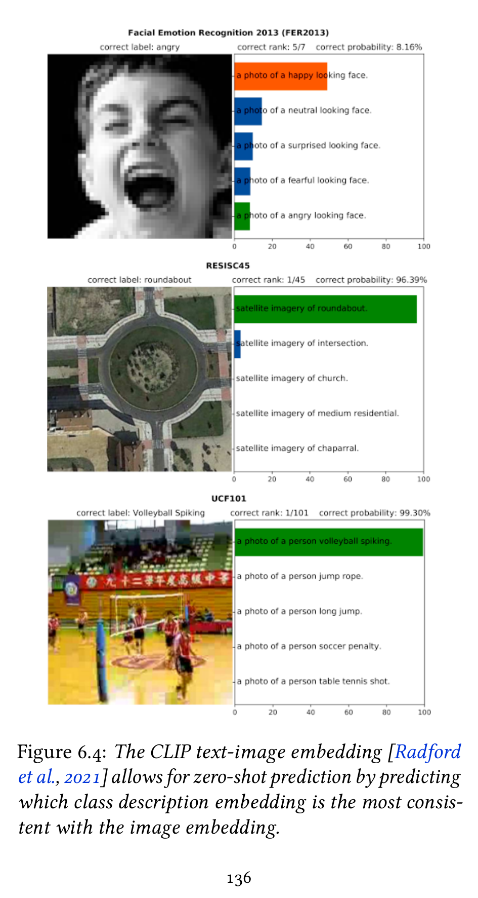

*** 6.7 Reinforcement learning
In a Markov Decision Process, state $S_t$ and reward $R_t$ evolve under actions $A_t$. A policy $\pi$ chooses actions to maximize expected discounted return $\mathbb{E}[\sum_{t\ge0}\gamma^tR_t]$, with $0<\gamma<1$. The optimal state-action value $Q(s,a)$ satisfies the Bellman equation

\begin{equation}
Q(s,a)=\mathbb{E}\left[R_t+\gamma\max_{a'}Q(S_{t+1},a')\mid S_t=s,A_t=a\right].
\end{equation}

Deep Q-Network (DQN) estimates $Q$ from game frames. Training uses replayed transitions $(s_n,a_n,r_n,s'_n)$ and minimizes

\begin{equation}
\mathcal{L}(w)=\frac{1}{N}\sum_{n=1}^{N}\left(Q(s_n,a_n;w)-y_n\right)^2,
\end{equation}

where $y_n=r_n$ at episode termination and otherwise $r_n+\gamma\max_aQ(s'_n,a;\bar{w})$; the target parameters $\bar{w}$ are held fixed. An $\epsilon$-greedy policy explores randomly with probability $\epsilon$ and otherwise takes the greedy action. (PDF pp. 137–140.)

#+CAPTION: Figure 6.5. DQN state-value evolution during a game of Breakout. (PDF p. 139.)
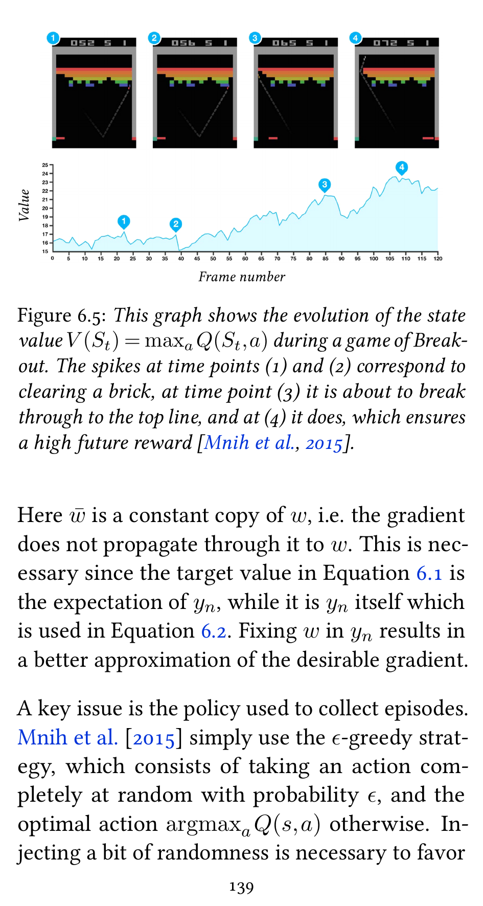

The plotted state value is $V(S_t)=\max_a Q(S_t,a)$. Its spikes correspond to clearing bricks and breaking through the top line, events that signal high future reward. DQN keeps a fixed copy $\bar{w}$ of the parameters when computing target values, so gradients do not propagate through the target; this improves the desired gradient approximation. (PDF p. 139.)

** Chapter 7: Synthesis
Synthesis fits a density model to training samples and provides a way to sample from it. (PDF p. 141.)

*** 7.1 Text generation
Text generation commonly uses an autoregressive attention model such as GPT. Large Language Models trained on extensive text corpora acquire broad linguistic and factual patterns, enabling few-shot prediction from examples in a prompt and, sometimes, multi-step problem solving. For assistant applications, fine-tuning and Reinforcement Learning from Human Feedback (RLHF) adapt pretrained models to human preferences: demonstrations can directly fine-tune the model, while ratings can train a reward model. (PDF pp. 142–144.)

#+CAPTION: Figure 7.1. Few-shot prediction examples from a GPT model. (PDF p. 143.)
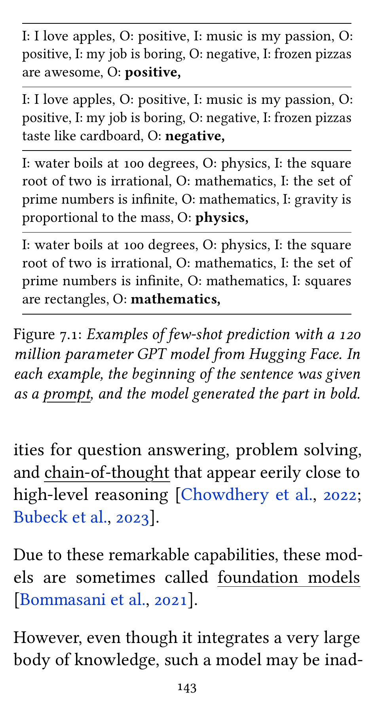

Large language models can exhibit question-answering, problem-solving, and chain-of-thought behaviors that resemble high-level reasoning. Because they integrate broad knowledge, such models are sometimes called *foundation models* [Bommasani et al., 2021], although they can still be inaccurate. (PDF p. 143.)

*** 7.2 Image generation
Diffusion models define a gradual degradation process that transforms data into a tractable noise distribution, then train a deep denoiser to reverse it. Starting from $x_0$ sampled from data, the forward process samples $x_{t+1}\sim p(x_{t+1}\mid x_t)$ until $x_T$ is approximately normal. The reverse model estimates $p(x_{t-1}\mid x_t)$; repeatedly sampling it from noise generates data-like images. For the formulation described, the reverse step is

\begin{equation}
x_{t-1}\mid x_t\sim\mathcal{N}\left(x_t+f(x_t,t;w),\sigma_t\right),
\end{equation}

with analytically defined $\sigma_t$. Text conditioning can guide image generation by adding a bias that increases similarity to the text description. (PDF pp. 145–148.)

#+CAPTION: Figure 7.2. Denoising diffusion gradually transforms white noise into an image. (PDF p. 146.)
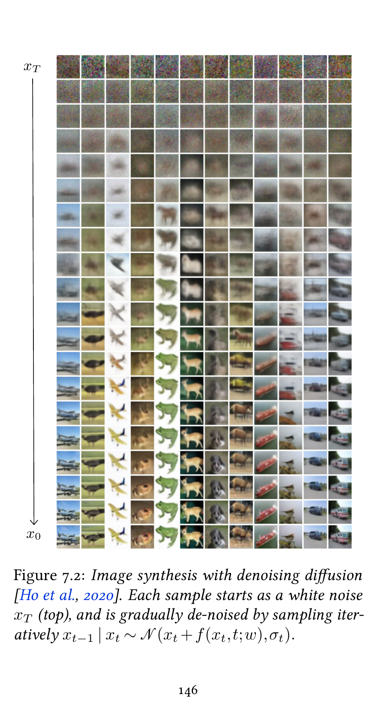

** Chapter 8: The Compute Schism
Large models may exceed consumer hardware in memory and compute requirements, while inference or task adaptation can be made feasible under tight resource limits. Local execution may also be desirable for cost and confidentiality. (PDF p. 149.)

*** 8.1 Prompt Engineering
Prompt engineering specializes or improves a language model by carefully crafting its input, moving information otherwise encoded in parameters into the prompt. Few-shot examples and chain-of-thought prompts can help elicit useful behaviors. Retrieval-Augmented Generation (RAG) retrieves documents whose embeddings match a user query, joins them with instructions in a prompt, and uses the language model to generate a response grounded in that material. Context length is constrained in part by the quadratic cost of standard attention. (PDF pp. 150–152.)

#+CAPTION: Figure 8.1. Chain-of-thought prompting example comparing direct and step-by-step answers. (PDF p. 151.)
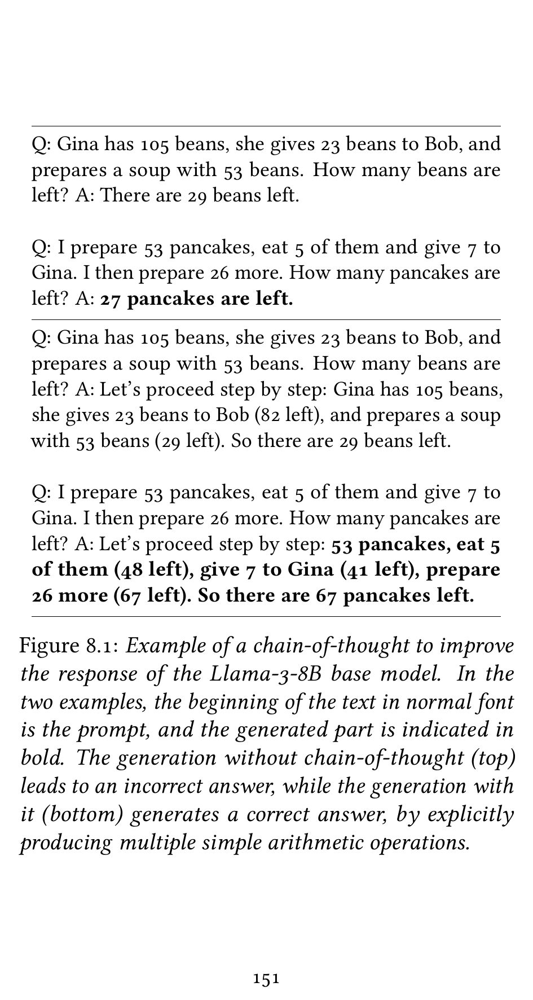

*** 8.2 Quantization
Inference for an individual model is often limited more by memory capacity and bandwidth than by arithmetic. Quantization stores parameters at lower precision; large models can retain strong performance at 6 or 4 bits per parameter while using less memory and often running faster. Post-training quantization assigns formats to weight matrices, potentially using different precision for attention and feed-forward weights.

For example, Q4_1 quantizes blocks of 32 values using a scale $d$ and bias $m$ in FP16, and stores each value as a 4-bit integer $q\in\{0,\ldots,15\}$, dequantized as $\tilde{x}=dq+m$. A block uses 20 bytes rather than 64 bytes for 32 FP16 values. Quantization-aware training instead simulates quantization in the forward pass while retaining high-precision parameters and gradients. (PDF pp. 153–155.)

#+CAPTION: Figure 8.2. Perplexity of quantized Llama models versus parameter memory footprint. (PDF p. 154.)
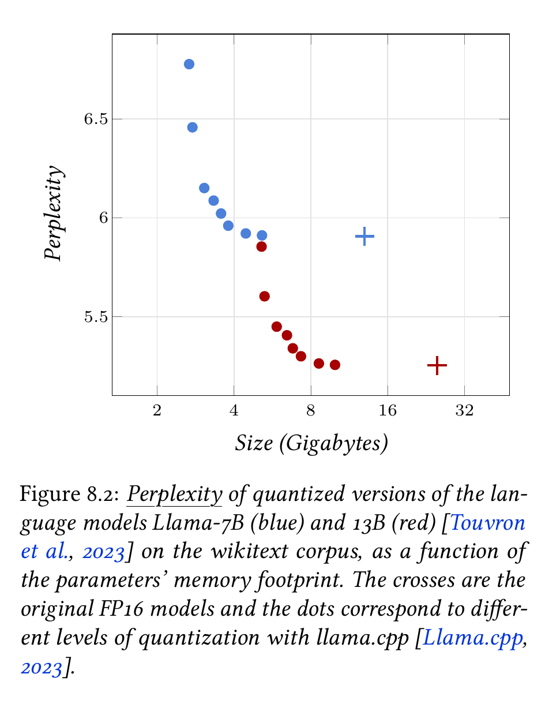

Quantization can assign different bit widths to different weight matrices; for example, more bits may be used for attention $W^V$ weights and feed-forward weights. One llama.cpp quantization format is Q4_1. (PDF p. 154.)

*** 8.3 Adapters
Adapters add a small number of trainable parameters to a frozen pretrained model. Low-Rank Adaptation (LoRA) replaces $XW^T$ by $X(W+BA)^T$, where $W\in\mathbb{R}^{C\times D}$ is frozen, $A\in\mathbb{R}^{R\times D}$ and $B\in\mathbb{R}^{C\times R}$ are trainable, and $R\ll\min(C,D)$. Initializing $B=0$ makes the adapted model initially identical to the base model. The adapter typically requires only a few percent as many parameters as the base model and can be merged into $W$ for inference. QLoRA combines a quantized base model with unquantized low-rank adapters. (PDF pp. 156–158.)

*** 8.4 Model merging
Fine-tuned versions of a common base model can be combined without additional training. If $\theta$ is the base parameter vector, task-specific parameters $\theta_t$ define residuals $\tau_t=\theta_t-\theta$; experiments show that $\theta+\sum_t\tau_t$ can exhibit multiple task capabilities. Methods reduce interference among residuals, while other approaches recombine layers. (PDF pp. 159–160.)

** The Missing Bits
The book omits several important topics. Recurrent Neural Networks (RNNs), including LSTM and GRU, process sequences through hidden states; their sequential computation is a drawback relative to attention, while newer structured recurrent approaches include QRNN, S4, and Mamba. Autoencoders map signals to low-dimensional latent representations and reconstruct them; Variational Autoencoders impose a latent distribution for generation. Generative Adversarial Networks pair a generator with a discriminator trained to distinguish generated from real samples. Graph Neural Networks process graph-structured data by aggregating neighboring vertex representations. Self-supervised learning constructs label-free tasks, such as recovering masked signal portions or learning representations invariant to semantic-preserving transformations, to exploit unlabeled data. (PDF pp. 161–166.)

** Bibliography
The bibliography spans PDF pages 167–178. The source pages are included below as page captures to preserve every reference and its formatting.

#+CAPTION: Bibliography, PDF page 167.
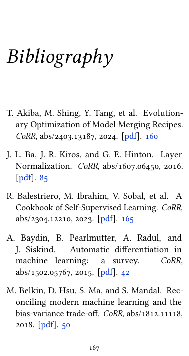
#+CAPTION: Bibliography, PDF page 168.
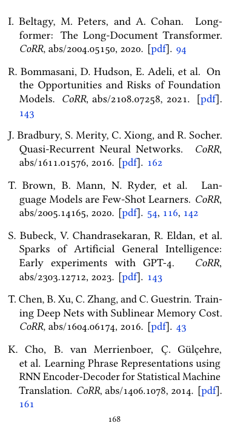
#+CAPTION: Bibliography, PDF page 169.
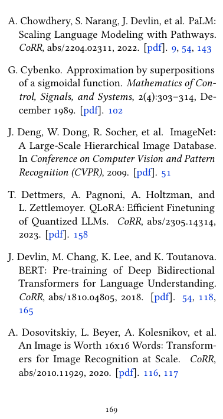
#+CAPTION: Bibliography, PDF page 170.
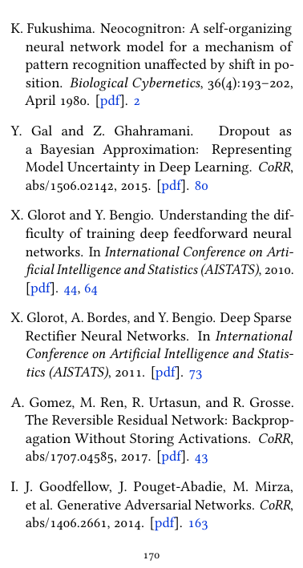
#+CAPTION: Bibliography, PDF page 171.
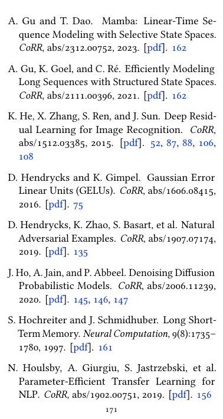
#+CAPTION: Bibliography, PDF page 172.
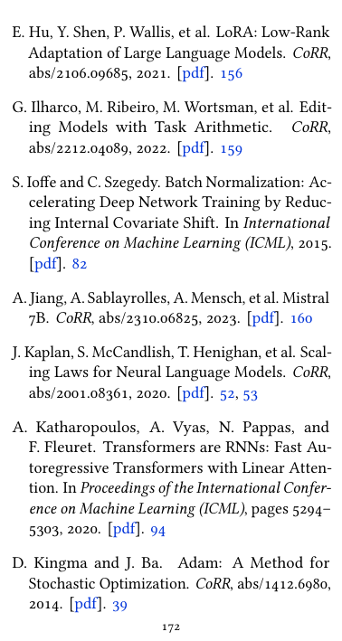
#+CAPTION: Bibliography, PDF page 173.
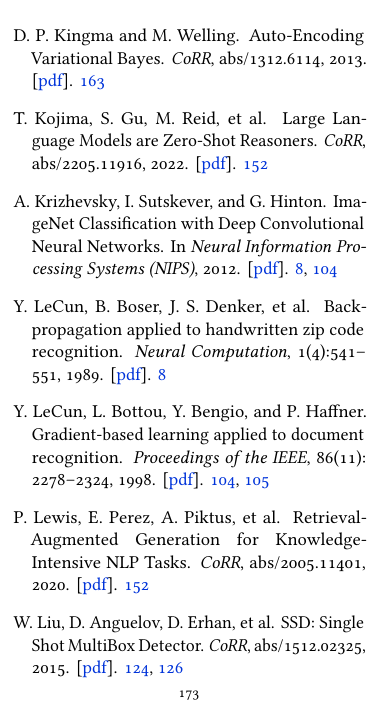
#+CAPTION: Bibliography, PDF page 174.
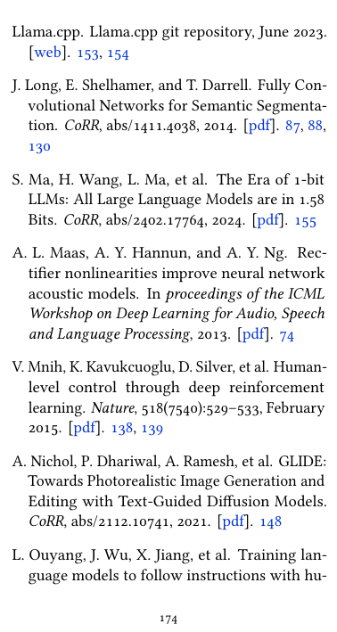
#+CAPTION: Bibliography, PDF page 175.
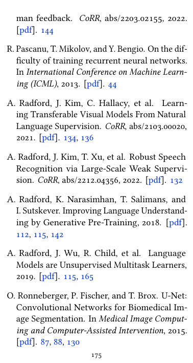
#+CAPTION: Bibliography, PDF page 176.

#+CAPTION: Bibliography, PDF page 177.

#+CAPTION: Bibliography, PDF page 178.

** Index
The index spans PDF pages 179–189; its alphabetical entries and page references are preserved in these source-page captures.

#+CAPTION: Index, PDF page 179.

#+CAPTION: Index, PDF page 180.

#+CAPTION: Index, PDF page 181.

#+CAPTION: Index, PDF page 182.

#+CAPTION: Index, PDF page 183.

#+CAPTION: Index, PDF page 184.

#+CAPTION: Index, PDF page 185.

#+CAPTION: Index, PDF page 186.

#+CAPTION: Index, PDF page 187.

#+CAPTION: Index, PDF page 188.

#+CAPTION: Index, PDF page 189.

